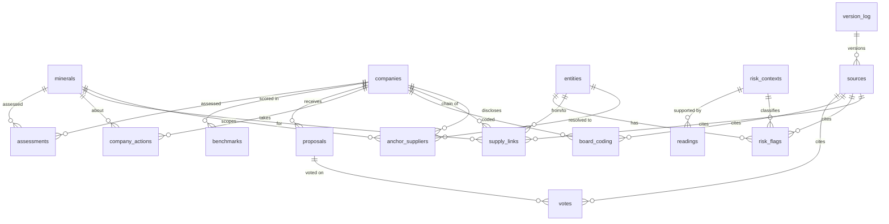

# 02 — Specification

**Document status:** Draft v0.1 (planning stage — no application code yet)
**Last updated:** 2026-11-09
**Related documents:** [Concept](01-concept.md) · [Plan](03-plan.md) · [Backlog](04-backlog.md)

**Conventions**
- `FR-xx` = functional requirement; `NFR-xx` = non-functional requirement; `AC` = acceptance criterion.
- **Must / Should / Could** follow MoSCoW (see the [backlog](04-backlog.md)).
- *(verify)* = link or fact not yet confirmed at the stated access date.
- **A-xx** = assumption; **Q-xx** = open question. Both are listed at the end.

---

## Contents

1. [Glossary](#1-glossary)
2. [Functional requirements](#2-functional-requirements)
3. [Source attribution and caveat requirements](#3-source-attribution-and-caveat-requirements)
4. [Non-functional requirements](#4-non-functional-requirements)
5. [Risk taxonomy](#5-risk-taxonomy)
6. [Data model](#6-data-model)
7. [View-by-view specification](#7-view-by-view-specification)
8. [Methodology page outline](#8-methodology-page-outline)
9. [Data source interfaces and caching](#9-data-source-interfaces-and-caching)
10. [Seed source register](#10-seed-source-register)
11. [Technology stack options](#11-technology-stack-options)
12. [Thesis integration and versioning](#12-thesis-integration-and-versioning)

---

## 1. Glossary

| Term | Meaning in this project |
|---|---|
| **Anchor supplier** | A refiner, smelter, cathode or cell maker, or other key supplier that a company **names in its own reports**. Upstream tracing starts here. |
| **Disclosed link** | A supply relationship the company (or the supplier) states publicly. |
| **Observed link** | A supply relationship that appears in Sayari trade, corporate or ownership data. |
| **Tier** | Distance from the company: tier 1 = direct supplier; tier 2 = supplier's supplier; tier 3+ = further upstream. |
| **Risk context** | The type of rights risk a flag points to (state-imposed forced labour, child labour, etc.). Shown by **colour + icon + text**. |
| **Evidence level** | How strong the evidence behind a flag is, E1 (strongest) to E4. Shown by **badge**. |
| **Risk indicator** | A flag that suggests risk. It is **never** a finding that abuse occurred. |
| **Big Three** | BlackRock, Vanguard and State Street Global Advisors. |
| **Stewardship team** | The group inside an asset manager that decides votes. It can differ between index and active funds. |
| **Thesis snapshot** | The frozen, versioned dataset the thesis cites. |
| **Public build / research build** | Two outputs of the same pipeline. The Sayari licence permits publication (confirmed 2026-11-09), so the public build includes entity names, Sayari entity IDs and flags. The research build adds only internal lineage fields (`raw_ref`) that point to the private raw cache. |

---

## 2. Functional requirements

### 2.1 Supply chain mapping — anchor-supplier method

| ID | Requirement | Priority | Acceptance criteria |
|---|---|---|---|
| **FR-01** | Keep an **anchor-supplier register** per company and mineral, built from the company's own disclosures: smelter/refiner lists, supplier lists, responsible-sourcing reports, EMRT/CMRT summaries. | Must | Each anchor has: company, mineral, supplier name as disclosed, role (refiner, cathode, cell, component), disclosure document (`source_id`), disclosure year. No anchor is created without a source. |
| **FR-02** | Trace **upstream from each anchor** in Sayari, never from the brand, with set parameters: mineral HS codes (from `minerals` config), date window (default: 24 months before the query date), maximum depth (default 3). | Must | Every trace stores its parameters, query timestamp and the raw response in the local cache. Re-running with the same cache gives identical derived tables. |
| **FR-03** | Classify each link as **disclosed only**, **observed only** or **disclosed and observed**, and show the classes differently. Report the **gap** (disclosed-not-observed and observed-not-disclosed) as a finding. | Must | `supply_links.link_basis` is one of three values. Company and mineral views show gap counts. The explorer distinguishes the three classes by line marker and text label, not by colour alone. |
| **FR-04** | Record for each link: tier, mineral, date range of underlying records, query date, Sayari entity IDs of both ends, and the source. | Must | No `supply_links` row has an empty tier, mineral, query date (for observed links) or `source_id`. |
| **FR-05** | **Entity-resolution review:** the researcher confirms that each anchor maps to the correct Sayari entity. Candidates are compared on identifiers, country and relationships, and match confidence is recorded. | Must | Each anchor has `match_status` (confirmed / probable / rejected) and a note. Links that depend on "possibly same as" (PSA) matches are marked and shown with a "PSA — weaker match" label. |

### 2.2 Risk taxonomy

| ID | Requirement | Priority | Acceptance criteria |
|---|---|---|---|
| **FR-06** | Assign every displayed risk flag to one **risk context** (§5.1). Colour encodes the context. | Must | 100% of displayed flags have a context. Unmapped Sayari flags are not displayed and are listed in a QA report. |
| **FR-07** | Assign every flag an **evidence level** E1–E4 (§5.2), shown as a badge. | Must | Badge visible next to each flag, with text (for example "E1 Official list"). |
| **FR-08** | Encode **tier** by line style: solid = tier 1 (direct); dashed = tier 2; dotted = tier 3+. | Must | Legend present in every view showing links. Line style is also stated in hover text. |
| **FR-09** | Keep a **risk-factor mapping configuration** that maps each Sayari risk-factor ID to a risk context, an evidence level and a display rule (show / show with note / hide). | Must | Config file validated by schema. Adding or changing a mapping needs no code change. |
| **FR-10** | Use a **colour-blind-safe palette**. Every colour is paired with an icon and a text label. | Must | Palette passes a CVD simulation check (deuteranopia, protanopia, tritanopia). No view relies on colour alone. |
| **FR-11** | **Wording rule:** flags are called "risk indicators". No view or export states or implies that a company uses forced labour. | Must | Banned-phrase lint passes on all templates and researcher text (§7.10). |

### 2.3 Risk context library

| ID | Requirement | Priority | Acceptance criteria |
|---|---|---|---|
| **FR-12** | One library page per risk context, with: summary (3–4 sentences); affected minerals and products; legal significance (UFLPA, EU Forced Labour Regulation, ILO Conventions 29 and 105 and Protocol of 2014, ILO 138/182 for child labour, UNGPs, potential crimes against humanity where relevant); mapped Sayari flags; further reading; government and company responses. | Must | All sections present on each page or marked "none found as of [date]". |
| **FR-13** | **Reading inclusion rules:** source types limited to UN bodies, major NGOs, academic research centres, official government lists and documents, and reputable news (labelled "journalism"). Date floor: 1 January 2020. Older baseline works may appear in a separate "Background (pre-2020)" list. At least **two independent sources** per context. Each reading has title, publisher, date, type, URL and a one-line relevance note. | Must | Schema validation enforces fields. Each context has ≥ 2 readings from different publishers dated 2020 or later. |
| **FR-14** | Each library page shows a **last reviewed** date and the next review date (default: every 6 months, and before the snapshot freeze). | Should | Date visible. Build warns when a review is overdue. |
| **FR-15** | Where a context involves a contested state position (for example XUAR), the library includes the official response of the government concerned, for balance (for example Annex A of the OHCHR 2022 assessment). | Must | XUAR page lists the Government of China response with a neutral description. |

### 2.4 Views

| ID | Requirement | Priority | Acceptance criteria |
|---|---|---|---|
| **FR-16** | **Executive summary per company** (all minerals) — layout in §7.1. | Must | See §7.1 AC. |
| **FR-17** | **Executive summary per mineral** (all companies) — same layout. | Must | See §7.1 AC. |
| **FR-18** | **One-page print/PDF version** of each executive summary. | Must | Prints to one A4 / US Letter page with caveat, version, snapshot ID and source list (short form, with link to the full list). |
| **FR-19** | **Company view** — §7.2. | Must | See §7.2 AC. |
| **FR-20** | **Compare mode** — two companies side by side. | Should | Same sections aligned. Each side keeps its own sources and caveat. |
| **FR-21** | **Mineral view** — all companies' exposure for one mineral (§7.3). | Must | See §7.3 AC. |
| **FR-22** | **Supply chain explorer** — tiered flow mine region → refiner → cell/component maker → company (§7.4). | Must | See §7.4 AC. |
| **FR-23** | **Board oversight grid** — coded indicators by company and year with source links (§7.5). | Must | See §7.5 AC. |
| **FR-24** | **Proposals and votes timeline** 2022–2026 with each Big Three vote and the stewardship team that voted (§7.6). | Must | See §7.6 AC. |
| **FR-25** | **Risk context library** view (§7.7). | Must | See FR-12–FR-15. |
| **FR-26** | **Methodology and limitations** page (§8), complete enough to cite. | Must | All sections in §8 present. Page has its own version and citation line. |
| **FR-27** | **Data download** — CSV of every published table, with version number and a data dictionary (§7.9). | Must | See §7.9 AC. |

### 2.5 Analysis and coding

| ID | Requirement | Priority | Acceptance criteria |
|---|---|---|---|
| **FR-28** | **Board coding** per company and proxy year using the CHRB board-level accountability indicators (theme A.2) plus project indicators (§6.3 `board_coding`). | Must | Each cell has value, evidence quote reference (page/section), `source_id` and coder. |
| **FR-29** | **Second-reviewer check** on a random, stratified sample of coded cells (default ≥ 20%), with agreement statistics and resolution notes. **Deferred 2026-11-09** (no second reviewer for now). Until then, the methodology page states that coding was done by one coder. | Could (deferred) | If activated: `board_coding.review_status` recorded and agreement reported. Until then: single-coder status stated on the methodology page. |
| **FR-30** | **Company actions** register: remedy, mitigation, recycling, substitution, exit, engagement, other. Each is dated and sourced. | Must | Each action has date (or date range), type, mineral, description, `source_id`. |
| **FR-31** | **Proposals register** including voted, **excluded** (with or without SEC no-action relief), **withdrawn** and **not presented**. | Must | `proposals.status` covers all outcomes. Excluded and withdrawn proposals appear on the timeline. |
| **FR-32** | **Votes** for each Big Three manager per proposal, using the fund-selection rule (§7.6). Record stewardship team, fund(s), vote, and whether the manager's funds split. | Must | Each vote row cites its N-PX filing or manager disclosure. |
| **FR-33** | **Remedy-or-exit assessment** per company–mineral pair. The researcher writes it using structured inputs: highest-severity context, strongest evidence level, leverage indicators, company actions. | Must | Assessment text stored with author, review date and inputs. Never auto-generated. |

### 2.6 Configuration and extensibility

| ID | Requirement | Priority | Acceptance criteria |
|---|---|---|---|
| **FR-34** | **Minerals configuration**: name, HS codes (confirmed through Sayari HS lookup), high-risk regions, relevant risk contexts, mapped flags, default trade window. | Must | Adding a mineral row plus readings makes it appear in all views with no code change (tested with a dummy mineral). |
| **FR-35** | **Companies configuration**: name, ticker, CIK, control structure, fiscal year end, minerals in scope, Sayari entity ID (research build only if the licence requires). | Must | Adding a company row plus anchors makes it appear with no code change. |
| **FR-36** | **Build profiles**: `public` and `research`. The Sayari licence permits publication (confirmed 2026-11-09). The public build therefore excludes only internal lineage fields (`raw_ref`) and raw cache content. | Should | Publish rules defined in config. The public build fails if a `raw_ref` field or raw response leaks (automated test). |

### 2.7 Versioning and thesis integration

| ID | Requirement | Priority | Acceptance criteria |
|---|---|---|---|
| **FR-37** | **Version log**: every published dataset has a semantic version, date, change summary and checksum manifest. | Must | `version_log` row per release. Version shown in footer, print and CSV. |
| **FR-38** | **Thesis snapshot**: a frozen dataset version (e.g. `v1.0.0-thesis`, date) that is tagged, archived and never changed. Later updates create new versions. | Must | Snapshot files are read-only in the repository (tag + checksum). The site can show the snapshot or "latest", with a visible banner saying which. |

---

## 3. Source attribution and caveat requirements

These are **mandatory**, testable and apply to **every view, executive summary, print/PDF version and CSV export**.

### 3.1 The standard Sayari caveat (exact text)

> Supply chain links and risk flags are derived from Sayari Graph data (queried [date]). They are risk indicators based on trade, corporate and third-party records, not findings that any company uses forced labour. Data may be incomplete, contain entity-matching errors, or omit flows not captured in trade records.

`[date]` is the query date (or range "YYYY-MM-DD to YYYY-MM-DD") of the Sayari data shown.

### 3.2 Requirements

| ID | Requirement | Acceptance criteria (testable) |
|---|---|---|
| **FR-39** | Every data point, flag, link and chart derived from Sayari is labelled **"Source: Sayari"**. | Automated test: every rendered element bound to a Sayari-derived record carries the label (visible or in an accessible tooltip). Charts carry it in the caption. |
| **FR-40** | Sayari query date and entity ID(s) are available **on hover and in a detail panel** (keyboard-accessible). Entity IDs are published (licence confirmed 2026-11-09). | Test: focus or hover on a Sayari element shows the query date and entity ID(s). |
| **FR-41** | The standard caveat (§3.1) appears on every view, executive summary, print/PDF version and CSV export that uses Sayari data. | Test: each page template and print stylesheet contains the caveat block with the date filled in. Each CSV with Sayari-derived rows includes the caveat in a header comment line **and** in the accompanying `README` of the download bundle. |
| **FR-42** | Content found through Tavily cites the **original publisher** (title, publisher, date, URL). Tavily is never shown as a source. It is credited only in the methodology ("discovery tool"). | Test: no `sources.publisher` or display citation equals "Tavily". The methodology names Tavily as a discovery tool. |
| **FR-43** | All other data (SEC filings, company reports, benchmarks, vote records) name the **specific document, publisher, date and link**. | Test: every non-Sayari record has a `source_id` whose row has `title`, `publisher`, `publication_date` and `url` filled. |
| **FR-44** | The `sources` table records source name, type, publisher, date, URL **or** entity ID, and query/access date for every record. **Exports keep these columns.** | Schema test on `sources`. Export test: every exported table either contains the source columns or a `source_id` plus the exported `sources.csv` in the same bundle. |

---

## 4. Non-functional requirements

| ID | Category | Requirement | Acceptance criteria |
|---|---|---|---|
| **NFR-01** | Reproducibility | Cache every raw API response (Sayari, Tavily, EDGAR) with request parameters, timestamp and a content hash. | Re-running transforms offline from cache gives byte-identical derived tables. |
| **NFR-02** | Reproducibility | Transforms are deterministic: sorted outputs, fixed random seeds (for example the reviewer sample), pinned dependency versions. | CI runs the pipeline twice and compares checksums. |
| **NFR-03** | Licence compliance | Confirm Sayari and other licence terms before publishing. If needed, publish derived summaries only. Record terms in `DATA_NOTICE.md`. | Licence check recorded in the plan (Phase 0 exit). Public build obeys field-level publish rules. |
| **NFR-04** | Security | Secrets only in environment variables (`.env`, git-ignored). `.env.example` holds names only. Secret scanning in CI. | No secrets in the repository; secret scan passes. |
| **NFR-05** | Privacy | No personal data beyond public information on corporate directors and officers as disclosed in filings. No data on workers or affected individuals. | Data review checklist passes before each release. |
| **NFR-06** | Accessibility | WCAG 2.2 AA target: contrast, text alternatives for charts (table fallback), colour never the only signal. | Automated accessibility check plus manual check of each view. |
| **NFR-07** | Accessibility | Full keyboard navigation: focus order, visible focus, tooltips reachable by keyboard. | Manual keyboard test script passes. |
| **NFR-08** | Performance | Pilot runs on a laptop. Full pipeline from cache < 5 min. Each page loads < 3 s on a typical connection. | Timed in CI or locally. |
| **NFR-09** | Hosting | Static or lightweight hosting (for example GitHub Pages). No server-side database needed for the public site. | Site served as static files. |
| **NFR-10** | Maintainability | Minerals, companies, risk mappings, board indicators and readings are configuration-driven (YAML/CSV with schemas). | Adding a mineral passes test FR-34 with no code change. |
| **NFR-11** | Neutral wording | Neutral, careful language about named companies, regions and groups. Spell "Uyghur". Banned-phrase lint (§7.10). | Lint passes. Wording review signed off before each public release. |
| **NFR-12** | Data quality | Schema validation (types, required fields, enumerations, foreign keys) on every table. | Validation step blocks the build on failure. |
| **NFR-13** | Polite API use | Respect rate limits. Back-off and retry. Declared `User-Agent` for SEC EDGAR as required by SEC fair-access policy (≤ 10 requests per second). | Spike results (Phase 0) confirm settings. No 429/403 in normal runs. |
| **NFR-14** | Print fidelity | Executive summaries print on one page with caveat, version and sources. | Print test on A4 and US Letter. |
| **NFR-15** | Browser support | Current versions of Chrome, Firefox, Safari and Edge. Usable at 1366×768 and 1440×900. | Manual check. |
| **NFR-16** | Auditability | Every derived row can be traced to its raw cached response or document. | Lineage column (`raw_ref`) present in research build. |

---

## 5. Risk taxonomy

### 5.1 Risk contexts (colour = context)

Colours are a **proposal** to validate with a colour-vision-deficiency (CVD) simulator in Phase 1. Every context also has an **icon shape** and a **text label**, so colour is never the only signal.

| Code | Risk context | Colour (proposed hex) | Icon | Text label | Leverage implication (severity-and-leverage test) | Example |
|---|---|---|---|---|---|---|
| `SIFL` | State-imposed forced labour | Dark red `#7A0019` | ◆ diamond | "State-imposed forced labour" | Little buyer leverage → points toward **exit** | Labour-transfer programmes in the XUAR |
| `CHILD` | Child labour in artisanal mining | Orange `#D55E00` | ▲ triangle | "Child labour (artisanal mining)" | Some leverage via programmes and formalisation → usually **remedy/mitigate** | Artisanal cobalt mining, DRC |
| `PIFL` | Privately imposed forced labour / debt bondage | Amber `#E6A700` | ● circle | "Privately imposed forced labour" | Leverage available → points toward **remedy** | Recruitment-fee debt bondage |
| `CONFLICT` | Conflict-linked sourcing | Purple `#5D3A9B` | ■ square | "Conflict-linked sourcing" | Depends on actor; OECD Annex II risks | Armed groups, eastern DRC 3TG |
| `OTHER` | Other rights risks (context only) | Grey `#6B6B6B` | ○ ring | "Other rights risk (context)" | Shown for context; not scored in the test | Indigenous land and water rights, environment |

> **Assumption A-10:** Orange and amber can be hard to tell apart for some readers with CVD. The icon and text label are therefore mandatory, and amber nodes also get a hatched fill pattern. Final hex values are set in Phase 1 after simulation.

### 5.2 Evidence strength (badge = evidence)

| Level | Badge text | Definition | Typical sources |
|---|---|---|---|
| **E1** | "E1 Official list" | The entity itself is on an official government list or subject to an import ban. | UFLPA Entity List; CBP Withhold Release Orders/Findings (active) |
| **E2** | "E2 Named in research" | The entity is named in a credible research report (UN body, major NGO, academic centre). | Sheffield Hallam University reports; ASPI "Uyghurs for Sale"; UN reports |
| **E3** | "E3 Network link" | A trade or ownership link to an E1/E2 entity or a high-risk region, at tier 1–3 or within three ownership hops. | Sayari sub-tier and ownership flags |
| **E4** | "E4 Product–country risk" | Only the product and country of origin carry risk. No entity-specific evidence. | US DOL List of Goods; regional location flags |

**Modifiers (shown as a second, smaller label):**
- **PSA** — the flag depends on a "possibly same as" entity match → label "PSA — weaker match". Treated as one level weaker for the "strongest evidence" key figure (A-11).
- **Former** — the listing has been lifted (for example a former WRO) → label "Former listing (date)".
- **Direct** — tier-1 trade history with a listed entity is shown as E3 with tier = 1 (Q-12).

### 5.3 Line style = tier; marker = link basis

| Attribute | Encoding |
|---|---|
| Tier 1 (direct) | Solid line |
| Tier 2 | Dashed line |
| Tier 3+ | Dotted line |
| Disclosed only | Line end marker "D" plus text "Disclosed by company" |
| Observed only | Line end marker "O" plus text "Observed in Sayari data" |
| Disclosed and observed | Marker "D+O" |

Line colour stays neutral (dark grey). Colour is reserved for the risk context of **nodes**.

### 5.4 Sayari risk-factor mapping (initial draft — `config/risk_factor_map.csv`)

Risk-factor IDs below were taken from Sayari's `lookup_risk_factors` reference in the Phase 0 spike (2026-11-09). Sayari's catalogue had 738 factors. Only forced-labour-relevant and minerals-relevant IDs are mapped. All others default to **hide**. Each base factor has a `psa_` variant ("may include possibly-same-as path"), which maps to the same context with the PSA modifier.

| Sayari risk-factor ID (base) | Context | Evidence | Display | Note |
|---|---|---|---|---|
| `forced_labor_xinjiang_uflpa` | SIFL | E1 | show | Entity on UFLPA Entity List |
| `wro_entity` | *per WRO* | E1 | show with note | Context assigned manually per WRO (some WROs concern private forced labour) |
| `former_wro_entity` | *per WRO* | E1 + "Former" | show with note | |
| `sheffield_hallam_university_forced_labor_entity` | SIFL | E2 | show | |
| `sheffield_hallam_university_forced_labor_reports_intermediary_entity` | SIFL | E2 | show | |
| `aspi_uyghur_forced_labor_report_entity` | SIFL | E2 | show | ASPI report is 2020 |
| `forced_labor_xinjiang_contractors` | SIFL | E2 | show with note | XPCC contractor list (government list, but not an import ban) — Q-13 |
| `reputational_risk_forced_labor` (+ `_recent`, `_breaking`, `_historic`) | *manual* | E2 if confirmed against original report | show with note | Adverse media; researcher must check the original publisher and classify SIFL vs PIFL |
| `forced_labor_uflpa_origin_direct` / `_subtier` / `_subtier_product_blueprint` | SIFL | E3 | show | Tier from flag (direct = 1, subtier = 2–3) |
| `forced_labor_xinjiang_origin_direct` / `_subtier` / `_subtier_product_blueprint` | SIFL | E3 | show | |
| `forced_labor_aspi_origin_direct` / `_subtier` / `_subtier_product_blueprint` | SIFL | E3 | show | |
| `forced_labor_sheffield_hallam_university_reports_origin_direct` / `_subtier` / `_subtier_product_blueprint` | SIFL | E3 | show | |
| `forced_labor_wro_origin_direct` / `_subtier` / `_subtier_product_blueprint` | *per WRO* | E3 | show with note | |
| `owned_by_*` / `owner_of_*` (UFLPA, ASPI, SHU, WRO, Xinjiang entity) and `*_adjacent` | as base | E3 | show | Ownership link up to 3 hops |
| `forced_labor_xinjiang_geospatial`, `forced_labor_xinjiang_registration`, `forced_labor_xinjiang_operations` | SIFL | E4 | show | Location only, no entity-specific evidence |
| `forced_labor_xinjiang_name`, `forced_labor_china_keywords` | SIFL | E4 | **hide** by default | Name-keyword heuristics; too weak for display (A-12) |
| `exports_ilab_child_labor` | CHILD | E4 | show | DOL list; DRC cobalt ore is listed |
| `exports_ilab_forced_labor` | PIFL | E4 | show with note | DOL list includes DRC cobalt ore for forced labour (DOL list as of 5 Sep 2024) |
| `exports_conflict_minerals` | CONFLICT | E4 | show | 3TG only — does **not** cover cobalt; relevant for later minerals and context |
| `forced_labor_xinjiang_cotton_entity` | — | — | hide | Not mineral-relevant |
| Sanctions, AML, CPI, SOE, PEP and other non-labour flags | — | — | hide | Out of scope; may be noted in methodology |

> **Gap noted in the spike:** Sayari has no specific factor for (a) privately imposed forced labour at mines other than the DOL product–country flag, (b) child labour at an entity level, or (c) Indigenous or environmental risks. These contexts therefore rely more on the risk context library and on research reports (E2, manual).

---

## 6. Data model

### 6.1 Principles
- Tidy tables: one row per observation, one column per variable.
- **Mineral is a dimension** on every exposure, action and link table, never a separate table per mineral.
- Every fact row has a `source_id` (FK → `sources`).
- Stable string IDs (for example `co` for cobalt, `TSLA`).
- Storage: CSV/Parquet in `data/derived/`, configuration in `data/config/` (YAML or CSV), raw responses in `data/raw/` and `data/cache/` (git-ignored).

### 6.2 Entity–relationship overview



### 6.3 Tables and fields

`PK` = primary key, `FK` = foreign key. Fields marked **(R)** were originally flagged as licence-restricted. The Sayari licence permits publication (confirmed 2026-11-09), so they are published. The only exception is `raw_ref`, an internal pointer to the private raw cache, which stays in the research build.

**`minerals`** (config)
| Field | Type | Notes |
|---|---|---|
| mineral_id | PK str | `co`, `graphite`, `li`, `mica` |
| name | str | |
| hs_codes | list[str] | Confirmed through Sayari HS lookup (cobalt: see §9.1) |
| high_risk_regions | list[str] | ISO country codes plus sub-national region notes |
| risk_contexts | list[FK] | Relevant contexts |
| default_window_months | int | Default 24 |
| notes | str | |

**`companies`** (config)
| Field | Type | Notes |
|---|---|---|
| company_id | PK str | Ticker, e.g. `TSLA` |
| name, cik, ticker | str | CIK from EDGAR |
| control_structure | enum | `widely_held`, `dual_class`, `controlled`, `significant_holder` + note |
| fiscal_year_end | date-part | |
| minerals_in_scope | list[FK] | |
| sayari_entity_id | str (R) | |
| pilot | bool | |

**`anchor_suppliers`**
| Field | Type | Notes |
|---|---|---|
| anchor_id | PK | |
| company_id, mineral_id | FK | |
| disclosed_name | str | As written in the disclosure |
| role | enum | `mine`, `refiner_smelter`, `precursor_cathode`, `cell_battery`, `component`, `recycler`, `other` |
| entity_id | FK → entities | After resolution |
| match_status | enum | `confirmed`, `probable`, `rejected` |
| match_note | str | Identifiers compared |
| disclosure_year | int | |
| source_id | FK | |

**`entities`**
| Field | Type | Notes |
|---|---|---|
| entity_id | PK | Internal ID |
| sayari_entity_id | str (R) | |
| name | str | |
| country | ISO-3 | |
| entity_type | enum | company, mine_site, region (synthetic node for mine region) |
| identifiers | json (R) | LEI and other public identifiers |
| source_id | FK | |

**`supply_links`**
| Field | Type | Notes |
|---|---|---|
| link_id | PK | |
| company_id, mineral_id | FK | Chain the link belongs to |
| from_entity_id, to_entity_id | FK | Upstream → downstream |
| tier | int | 1, 2, 3+ relative to the company (anchor = 1 unless disclosed deeper) |
| link_basis | enum | `disclosed`, `observed`, `both` |
| hs_codes_observed | list[str] | |
| records_date_min, records_date_max | date | Dates of underlying trade records |
| query_date | date | Sayari query date |
| psa_dependent | bool | |
| source_id | FK | |
| raw_ref | str (R) | Pointer to cached raw response |

**`risk_flags`**
| Field | Type | Notes |
|---|---|---|
| flag_id | PK | |
| entity_id | FK | |
| sayari_risk_factor_id | str | e.g. `forced_labor_uflpa_origin_subtier` |
| risk_context_id | FK | From mapping config, or manual |
| evidence_level | enum | E1–E4 |
| modifiers | list | PSA, Former |
| mineral_id | FK nullable | When the flag is product-specific |
| query_date | date | |
| manual_classification_note | str | For "per WRO"/"manual" mappings |
| source_id | FK | |

**`risk_contexts`** (config + library text)
| Field | Type | Notes |
|---|---|---|
| risk_context_id | PK | SIFL, CHILD, PIFL, CONFLICT, OTHER |
| label, colour_hex, icon, pattern | str | §5.1 |
| summary | text | 3–4 sentences |
| minerals_products | list | |
| legal_significance | text | |
| responses | text | Government and company responses |
| last_reviewed, next_review | date | |

**`readings`** (config)
| Field | Type | Notes |
|---|---|---|
| reading_id | PK | |
| risk_context_id | FK | Many-to-many allowed via list |
| title, publisher, publication_date, type, url | | type ∈ `un`, `ngo`, `academic`, `official_list`, `government`, `journalism`, `company`, `industry` |
| relevance | str | One line |
| discovered_via | enum | `tavily`, `manual`, `seed` (methodology only; never displayed as source) |
| access_date | date | |
| pre_2020_background | bool | |

**`board_coding`**
| Field | Type | Notes |
|---|---|---|
| coding_id | PK | |
| company_id | FK | |
| proxy_year | int | Year of annual meeting |
| indicator_id | FK → board indicators config | e.g. `CHRB_A2_1`, `P_COMMITTEE_CHARTER_HR` |
| value | int / enum | 0, 1, 2 or N/A (scoring in §8) |
| evidence_locator | str | Page/section reference; short quotation ≤ 40 words |
| coder, coded_date | str, date | |
| reviewer, review_value, review_status | | `agreed`, `resolved`, `pending` |
| source_id | FK | |

**`company_actions`**
| Field | Type | Notes |
|---|---|---|
| action_id | PK | |
| company_id, mineral_id | FK | |
| action_type | enum | `remedy`, `mitigation`, `recycling`, `substitution`, `exit`, `engagement`, `audit_certification`, `other` |
| date_start, date_end | date | |
| description | str | Neutral, as reported |
| reported_by | enum | `company`, `third_party` |
| source_id | FK | |

**`proposals`**
| Field | Type | Notes |
|---|---|---|
| proposal_id | PK | |
| company_id | FK | |
| meeting_date | date | |
| title, topic | str, enum | topic ∈ `forced_labour`, `human_rights_due_diligence`, `supply_chain_minerals`, `board_oversight_hr`, `other_related` |
| proponent | str | Organisation (no private individuals' personal details beyond what the proxy states) |
| status | enum | `voted`, `excluded_no_action`, `excluded_other`, `withdrawn`, `not_presented` |
| support_pct | float | Votes for ÷ (for + against), with the company's stated basis noted |
| board_recommendation | enum | |
| source_id | FK | |

**`votes`**
| Field | Type | Notes |
|---|---|---|
| vote_id | PK | |
| proposal_id | FK | |
| manager | enum | `blackrock`, `vanguard`, `state_street` |
| stewardship_team | str | e.g. BlackRock Investment Stewardship (index) vs active team; Vanguard index vs active teams |
| fund_name, fund_series_id | str | Selected by the fund-selection rule |
| vote | enum | `for`, `against`, `abstain`, `not_voted`, `split` |
| funds_split | bool | Manager's funds did not all vote the same way |
| source_id | FK | N-PX filing or manager disclosure |

**`benchmarks`**
| Field | Type | Notes |
|---|---|---|
| benchmark_id | PK | |
| company_id | FK | |
| benchmark | enum | `KTC_ICT`, `WBA_CHRB`, `LEAD_THE_CHARGE`, other |
| edition_year | int | |
| indicator, score, max_score | | |
| source_id | FK | |

**`assessments`** (researcher-written; supports FR-16, FR-17, FR-33)
| Field | Type | Notes |
|---|---|---|
| assessment_id | PK | |
| scope | enum | `company`, `mineral`, `company_mineral` |
| company_id, mineral_id | FK nullable | |
| headline | str | One sentence |
| key_findings | list[str] (3) | |
| remedy_or_exit | enum + text | `points_to_exit`, `points_to_remedy`, `mixed`, `insufficient_evidence` |
| what_to_watch | text | |
| confidence | enum + note | `high`, `medium`, `low` |
| author, reviewed_by, review_date | | |

**`sources`**
| Field | Type | Notes |
|---|---|---|
| source_id | PK | |
| source_name | str | Document or dataset title |
| source_type | enum | `sayari`, `sec_filing`, `company_report`, `benchmark`, `vote_record`, `official_list`, `un`, `ngo`, `academic`, `journalism`, `law` |
| publisher | str | Original publisher (never "Tavily") |
| publication_date | date | |
| url | str | HTTPS |
| sayari_entity_ids | list (R) | For Sayari sources |
| query_or_access_date | date | |
| licence_note | str | |

**`version_log`**
| Field | Type | Notes |
|---|---|---|
| version | PK str | SemVer, e.g. `1.0.0-thesis` |
| release_date | date | |
| is_thesis_snapshot | bool | |
| sayari_query_window | str | Date range of Sayari queries included |
| change_summary | text | |
| manifest_sha256 | str | Checksum of the derived file manifest |

### 6.4 Configuration files (planned layout)

```text
data/config/
  minerals.yaml
  companies.yaml
  risk_contexts.yaml
  risk_factor_map.csv
  board_indicators.yaml
  readings.yaml
  publish_rules.yaml     # field-level public/research rules (FR-36)
  palette.yaml
```

---

## 7. View-by-view specification

### Common elements (every view)
- **Header:** view title, dataset version, "Snapshot" or "Latest" banner.
- **Footer:** Sayari caveat (if Sayari data is used, FR-41), source count, link to methodology, citation line.
- **Legend:** risk context (colour + icon + text), evidence badges, tier line styles, link-basis markers.
- **Detail panel:** opens on click, Enter or Space. Shows sources, query dates and IDs (FR-40).
- **Accessible table fallback** for every chart (NFR-06).

### 7.1 Executive summaries (company and mineral)

**Constraints:** one screen with no scroll at 1366×768 and 1440×900 (browser chrome included); 350–450 words; researcher-written text only.

```text
┌───────────────────────────────────────────────────────────────────────────┐
│ [Company/Mineral] — Executive summary          v1.0.0-thesis · 2026-xx-xx │
│ HEADLINE: one sentence (≤ 30 words)                                        │
├──────────────────┬──────────────────┬──────────────────┬───────────────────┤
│ Highest-severity │ Strongest        │ Board oversight  │ Big Three support │
│ risk context     │ evidence level   │ score (year)     │ for related       │
│ ◆ State-imposed  │ E3 Network link  │ 9 / 16 (2026)    │ proposals         │
│ forced labour    │                  │                  │ BLK · VGD · SSGA  │
├──────────────────┴──────────────────┴──────────────────┴───────────────────┤
│ KEY FINDINGS (3 bullets, ≤ 45 words each)                                  │
│ REMEDY OR EXIT? Assessment against the UNGP severity-and-leverage test     │
│   (≤ 90 words; label: Points to exit / remedy / mixed / insufficient)      │
│ WHAT TO WATCH (≤ 50 words)                                                 │
│ CONFIDENCE: one line (High/Medium/Low + reason)                            │
│ → See full company view                                                    │
├───────────────────────────────────────────────────────────────────────────┤
│ Sayari caveat (FR-41) · Sources: n documents · Source: Sayari (queried …) │
└───────────────────────────────────────────────────────────────────────────┘
```

*Example values in the mock-up are placeholders, not findings.*

**Key figure definitions**
| Figure | Rule |
|---|---|
| Highest-severity risk context | Ordering: SIFL > CHILD ≈ PIFL > CONFLICT > OTHER (Q-14), among flags at E1–E3, or E4 if none. Shows context label and evidence level. |
| Strongest evidence level | Best (lowest number) evidence level among displayed flags for that scope; PSA counts one level weaker (A-11). |
| Board oversight score | Latest proxy year score from §8 board-coding rules, shown as "x / max (year)". |
| Big Three support | For related proposals in 2022–2026: count "for" votes out of proposals voted, **per manager** (e.g. "BLK 0/3 · VGD 0/3 · SSGA 1/3"). |

**AC (FR-16, FR-17, FR-18, FR-39–FR-41)**
- Word count 350–450 checked at build. Build fails outside the range.
- No vertical scroll at 1366×768 (automated screenshot test).
- Caveat present with filled date; "Source: Sayari" on Sayari-derived key figures; query date and IDs in detail panel.
- Print version on one page, including caveat, version, snapshot ID and short source list.
- `assessments.author` and `reviewed_by` are non-empty; there is no generated text.

### 7.2 Company view

| Section | Content | Source rule |
|---|---|---|
| Header | Company, ticker, control structure (e.g. widely held, dual-class), minerals in scope | Proxy statement / 10-K cited |
| Exposure by mineral | Per mineral: anchors (count), observed links by tier, highest context, strongest evidence, disclosed-vs-observed gap | "Source: Sayari" + caveat; disclosures cited |
| Company actions | Dated timeline of remedy, mitigation, recycling, substitution, exit, engagement | Each action cited |
| Board oversight by year | Mini-grid of indicators × years | Each cell links to source |
| Proposals and Big Three votes 2022–2026 | Includes excluded/withdrawn | N-PX / proxy / no-action letter cited |
| Benchmarks, litigation and regulatory events | KnowTheChain, CHRB, Lead the Charge; lawsuits; regulatory actions (dated, neutral) | Each cited |
| Sources | Full list for this company | `sources` |

**Compare mode (FR-20):** two companies selected; sections aligned in two columns; key figures side by side; each column keeps its own caveat date if query dates differ.

**AC:** All sections render for each pilot company. Empty sections say "No [item] found in sources reviewed as of [date]". Attribution and caveat (FR-39–FR-44) are present.

### 7.3 Mineral view

- Table and small-multiples chart: companies × (anchors, observed links by tier, highest context, strongest evidence, gap).
- Mineral facts: HS codes, high-risk regions, linked risk contexts, link to library pages.
- **AC:** All companies with the mineral in scope appear; the HS codes shown match `minerals` config; attribution and caveat are present.

### 7.4 Supply chain explorer

- Layout: left-to-right tiered flow — **mine region → refiner/smelter → precursor/cathode → cell/component maker → company**.
- Nodes are coloured, iconed and labelled by highest risk context, with an evidence badge.
- Links: line style by tier; marker by link basis (§5.3).
- Filters: company, mineral, evidence level, context, link basis, tier, PSA on/off.
- Detail panel per node and link: name, country, role, flags (with Sayari risk-factor ID and plain-language definition), query date, entity IDs (licence permitting), sources.
- Table view toggle (accessible fallback).
- **AC:** Keyboard can reach every node. Every Sayari element is labelled "Source: Sayari". The caveat is visible without opening a panel. Mine-region nodes from trade records are labelled "Region inferred from trade records" where applicable.

### 7.5 Board oversight grid

- Rows: indicators (CHRB A.2 and project indicators); columns: company × proxy year.
- Cell: value (0/1/2/N/A) with text and pattern; click opens evidence locator, short quote (≤ 40 words) and source link.
- Shows second-review status if a second-reviewer check is added later (FR-29, deferred).
- **AC:** Every non-N/A cell has a `source_id`. The score total per company-year matches §8 rules.

### 7.6 Proposals and votes timeline

- Horizontal timeline 2022–2026 per company; markers for each proposal (voted, excluded, withdrawn, not presented).
- Per proposal: topic, proponent, board recommendation, overall support %, and one row per manager (vote, stewardship team, fund, split flag).

**Fund-selection rule (approved 2026-11-09; FR-32):**
1. For each manager and meeting, take the vote of the manager's **largest US-domiciled index fund holding the company** on the record date, by net assets in the N-PX reporting period. Default candidates are, for BlackRock, iShares Core S&P 500 ETF; for Vanguard, Vanguard Total Stock Market Index Fund; for State Street, the largest SSGA-advised index fund for which SSGA votes. *(verify which entity casts votes for SPDR S&P 500 ETF Trust, a unit investment trust.)*
2. Check all N-PX-reported funds of that manager for the same item. If any differ, set `funds_split = true` and show "Split across funds" with a count.
3. Record the **stewardship team** behind the selected fund. From 2026, BlackRock and Vanguard each have separate index and active stewardship teams *(verify exact effective dates)*. If teams voted differently, show both.
4. Note pass-through or "voting choice" programmes as a limitation. Shares voted by clients are not attributed to the manager's stewardship team.

**Excluded proposals:** show exclusion basis (Rule 14a-8 ground cited in the no-action request or company statement) and the outcome. Note 2025–2026 changes in SEC staff practice on no-action requests *(verify: SEC Staff Legal Bulletin 14M, Feb 2025; SEC staff statement on the 2025–2026 proxy season)*.

**AC:** Every vote row cites the N-PX filing (accession number) or the manager's disclosure. Excluded and withdrawn proposals appear. The fund rule is stated on the page.

### 7.7 Risk context library

- Index page listing contexts with colour, icon and label.
- Context page per FR-12–FR-15; reading list table sortable by date, type and publisher; "Background (pre-2020)" section separate.
- **AC:** ≥ 2 independent post-2020 readings per context; review dates shown; the original publisher is cited for each item (never Tavily).

### 7.8 Methodology and limitations
See §8. **AC:** Every section present; version and citation line shown; Tavily credited as discovery tool only.

### 7.9 Data download

- A ZIP bundle per version: one CSV per published table + `sources.csv` + `data_dictionary.csv` + `README.txt` (caveat, version, licence, citation).
- Each Sayari-derived CSV begins with comment lines: `# Source: Sayari (queried YYYY-MM-DD)` and the full caveat.
- Filenames include the version: `supply_links_v1.0.0-thesis.csv`.
- **AC:** Export test checks for caveat, version and source columns (FR-44), and that no `raw_ref` field or raw response appears in public bundles (FR-36).

### 7.10 Wording rules (applied to all text)

| Avoid | Use instead |
|---|---|
| "Company X uses forced labour" | "Sayari data show a tier-2 trade link from an anchor supplier of Company X to an entity on the UFLPA Entity List (risk indicator, E3)." |
| "tainted", "complicit", "slave-made" | "linked to risk indicators", "exposed to risk context" |
| "proves", "confirms abuse" | "indicates risk", "is named in [report]" |
| "Uighur" and other spellings | "Uyghur" |
| "China uses slave labour" | "State-imposed forced labour risk in the XUAR, as assessed by [OHCHR 2022]" |

A banned-phrase list is kept in configuration and checked at build (NFR-11).

---

## 8. Methodology page outline

1. **Purpose and link to the research question** — the instrument's role in the thesis; the severity-and-leverage test.
2. **Scope** — minerals, companies, period, investors; pilot vs extension.
3. **Data sources** — Sayari (licence terms summary, query dates, entity ID handling); SEC EDGAR (DEF 14A, Form SD, N-PX); company reports; benchmarks; official lists; Tavily as **discovery tool only**.
4. **Anchor-supplier mapping method** — selecting anchors from disclosures; entity resolution and match confidence; upstream tracing parameters (HS codes, 24-month window, depth); disclosed vs observed; the gap as a finding.
5. **Risk taxonomy and evidence-strength definitions** — §5 tables; mapping config; PSA and "former" modifiers; unmapped flags.
6. **Board-coding framework and scoring rules**
   - Framework: WBA CHRB board-level accountability indicators (theme A.2: commitment from the top; board discussions; incentives and performance management; business model and risk) *(verify indicator names against the current CHRB methodology)*, plus project indicators:
     - P1 Named board committee with human-rights or supply-chain responsibility in its **charter**
     - P2 Charter or proxy names **forced labour** explicitly
     - P3 Charter or proxy names **minerals / responsible sourcing** explicitly
     - P4 Frequency of board or committee review of human-rights risk disclosed
     - P5 Board oversight of **remedy** process disclosed
     - P6 Board oversight of **exit / disengagement** decisions disclosed
     - P7 Director skills matrix includes human rights or supply chain expertise
   - Scale per indicator: 0 = not disclosed; 1 = general or partial; 2 = specific and meets the indicator in full. Score = sum; max shown alongside.
   - Coding unit: proxy year (annual meeting year), using DEF 14A, charters in force at filing, and the same-year responsible-sourcing report.
   - **Coding approach:** framework and scale approved 2026-11-09. Coding is done by a single coder; this is stated as a limitation. A second-reviewer check (stratified ≥ 20% sample, raw agreement and Cohen's κ) is **deferred** and can be added later without changing the data model.
7. **Voting analysis rules** — fund-selection rule; stewardship team splits; split votes; excluded and withdrawn proposals; support % basis; pass-through voting limitation.
8. **Reading-curation rules** — FR-13 inclusion rules; independence test (different publisher, not merely republishing); review cycle.
9. **Summary-writing protocol** — researcher drafts from structured inputs; wording rules; word limits; second read by advisor (or peer) for tone and accuracy; dated sign-off.
10. **Colour and accessibility conventions** — palette, icons, patterns, badges, line styles; WCAG target.
11. **Limitations** — trade-data blind spots (artisanal and informal flows, smuggling, unrecorded domestic flows, mixing at refiners); limited coverage of some trade corridors (see Phase 0 spike); entity-matching errors; disclosure bias; confidential board deliberations; time lags; correlation not causation; DOL and other list scope; voting data complexity.
12. **Ethics and legal wording** — risk indicators not findings; neutral wording; treatment of affected groups; no personal data; balance (e.g. government responses).
13. **Reproducibility, versioning and how to add a mineral** — cache, deterministic transforms, SemVer, thesis snapshot, step-by-step guide to adding a mineral through configuration.
14. **How to cite** — dataset citation with version and date.

---

## 9. Data source interfaces and caching

All credentials come from environment variables (see `.env.example`). **No keys in code or config files.**

### 9.1 Sayari

| Item | Detail |
|---|---|
| Access | Sayari MCP server (interactive spikes) and/or Sayari REST API (pipeline). Credentials: `SAYARI_CLIENT_ID`, `SAYARI_CLIENT_SECRET`. |
| Operations used | Entity search; entity summary/profile; upstream supply chain (filters: product HS codes, risk factors, countries, date range, max depth); beneficial owners; shipment search; supplier/buyer search; trade facets; HS-code lookup; risk-factor definitions; record (source document provenance). |
| Inputs | Anchor disclosed name + country + identifiers; mineral HS codes; date window; max depth. |
| Outputs stored | Raw JSON (cache, R); derived `entities`, `supply_links`, `risk_flags`. |
| Cobalt HS codes (confirmed via Sayari HS lookup, 2026-11-09) | `2605` / `260500` cobalt ores and concentrates; `2822` / `282200` cobalt oxides and hydroxides; `8105` cobalt mattes, intermediate products, unwrought cobalt, powders (`810520`), waste and scrap (`810530`), articles (`810590`). Downstream context: `850760` lithium-ion accumulators. `282739` (other chlorides) is too broad for cobalt chloride alone. Use only with a note (A-13). Cobalt sulphate is classed under `2833` — **to confirm in Phase 1** (Q-16). |
| Licence | Publication permitted (confirmed by the author, 2026-11-09). Entity names, IDs, flags and charts may be published with attribution and caveat. Raw responses stay in the git-ignored cache for reproducibility. |

### 9.2 Tavily

| Item | Detail |
|---|---|
| Access | Tavily MCP or API. Credential: `TAVILY_API_KEY`. |
| Operations | Search (filters: domains, date range), extract (read a page), map/crawl (later, for company report sites). |
| Use | **Discovery only**: find candidate readings and company documents. Each candidate is opened and cited to its **original publisher**. |
| Stored | Query, timestamp, result URLs (cache); curated items go to `readings` with `discovered_via = tavily`. |
| Rate limits | The Phase 0 spike hit HTTP 429 after about 8 calls in quick succession. Use throttling (≤ 1 request per 2–3 s), exponential back-off and caching. |

### 9.3 SEC EDGAR

| Item | Detail |
|---|---|
| Access | EDGAR full-text search, company submissions JSON and Archives. Declared `User-Agent` with organisation name and contact, set via `SEC_USER_AGENT` (required by SEC fair-access policy; automated requests without it received HTTP 403 in the Phase 0 spike). ≤ 10 requests per second. |
| Documents | DEF 14A (board, committees, proposals, vote results reference); 8-K Item 5.07 (final vote results); Form SD + Exhibit 1.01 (conflict minerals report: 3TG only; some companies also report cobalt/mica voluntarily through RMI EMRT); N-PX (fund votes, structured XML from 2024 reporting onward *(verify)*); committee charters (company websites). |
| Stored | Raw HTML/XML (cache); derived `board_coding` evidence, `proposals`, `votes`. |

### 9.4 Other sources
Manager vote disclosures (BlackRock, Vanguard, State Street), benchmark reports (KnowTheChain, WBA CHRB, Lead the Charge), official lists (UFLPA Entity List, CBP WRO/Findings, DOL List of Goods). Downloaded manually or by script, cached with access date.

### 9.5 Caching design

```text
data/cache/<source>/<YYYY-MM-DD>/<request_hash>.json   # raw response + metadata
data/cache/<source>/index.csv                           # request params, timestamp, hash, status
```
- Cache key = hash of (endpoint, normalised parameters).
- A **query run** has an ID; derived tables record the run ID and query date.
- "Refresh" creates a new dated folder; old caches are kept until the snapshot is archived (privately, if licence-restricted).
- Transforms read **only** from cache, never directly from APIs.

---

## 10. Seed source register

Access/check date for all rows: **2026-11-09** (automated HTTP check plus Tavily extraction). "OK" = page loaded or content confirmed. "Blocked" = server refused automated check; confirm manually. Moved links are replaced with the current official URL.

### 10.1 Standards and law
| Source | Publisher | URL | Status |
|---|---|---|---|
| UN Guiding Principles on Business and Human Rights (2011) | OHCHR | https://www.ohchr.org/sites/default/files/Documents/Publications/GuidingPrinciplesBusinessHR_EN.pdf | OK (old URL redirects here) |
| Business and Human Rights in Challenging Contexts: Considerations for Remaining and Exiting (2023) | OHCHR | https://www.ohchr.org/sites/default/files/documents/issues/business/bhr-in-challenging-contexts.pdf | OK |
| OECD Due Diligence Guidance for Responsible Supply Chains of Minerals from Conflict-Affected and High-Risk Areas (3rd ed.) | OECD | https://www.oecd.org/en/publications/oecd-due-diligence-guidance-for-responsible-supply-chains-of-minerals-from-conflict-affected-and-high-risk-areas_9789264252479-en | Blocked *(verify)* |
| Regulation (EU) 2024/3015 (Forced Labour Regulation) | EUR-Lex | https://eur-lex.europa.eu/eli/reg/2024/3015/oj/eng | OK |
| Forced Labour Single Portal (European Commission; launched with guidelines June 2026; prohibition applies from 14 Dec 2027) | European Commission | https://single-market-economy.ec.europa.eu/single-market/goods/forced-labour-regulation_en | OK |
| Directive (EU) 2024/1760 (CSDDD) | EUR-Lex | https://eur-lex.europa.eu/eli/dir/2024/1760/oj/eng | OK — consolidated text after 2026 Omnibus amendments *(verify)* |
| Commissioner's recommendations to strengthen modern slavery laws (2026) | Australian Anti-Slavery Commissioner | https://www.antislaverycommissioner.gov.au/news/commissioners-recommendations-strengthen-modern-slavery-laws | Timed out *(verify)* |
| Modern Slavery Bill 2026 (members' bill) | NZ Legislation | https://legislation.govt.nz/bill/members/2026/242/en/latest/ | Responded (202) *(verify content)* |

### 10.2 Official lists (evidence levels)
| Source | Publisher | URL | Status |
|---|---|---|---|
| Withhold Release Orders and Findings | US CBP | https://www.cbp.gov/trade/forced-labor/withhold-release-orders-and-findings | OK (redirects to https://www.cbp.gov/newsroom/stats/trade/withhold-release-orders-findings-dashboard) |
| UFLPA Entity List | US DHS (FLETF) | https://www.dhs.gov/uflpa-entity-list | OK (page last updated 28 Oct 2026; 190 entities per DHS) |
| UFLPA overview and Federal Register notices | US DHS | https://www.dhs.gov/uflpa | OK |
| List of Goods Produced by Child Labor or Forced Labor | US DOL ILAB | https://www.dol.gov/agencies/ilab/reports/child-labor/list-of-goods | Content confirmed via search (204 goods, 82 countries as of 5 Sep 2024; DRC cobalt ore listed); direct check blocked |

### 10.3 Risk context library — seed reading
| Source | Publisher | URL | Status |
|---|---|---|---|
| Assessment of human rights concerns in the XUAR (31 Aug 2022) | OHCHR | https://www.ohchr.org/sites/default/files/documents/countries/2022-08-31/22-08-31-final-assesment.pdf | OK |
| Annex A — response of the Government of China | OHCHR (publishing the government's response) | https://www.ohchr.org/sites/default/files/documents/countries/2022-08-31/ANNEX_A.pdf | OK |
| *Time to Recharge* (2017) — background, pre-2020 | Amnesty International | https://www.amnestyusa.org/reports/time-to-recharge/ | Blocked *(verify)* |
| Transition Minerals Tracker 2026 | Business & Human Rights Resource Centre | https://www.business-humanrights.org/en/from-us/briefings/transition-minerals-tracker-2026/ | OK |

### 10.4 Company filings (SEC EDGAR)
| Source | URL | Status |
|---|---|---|
| EDGAR full-text search | https://www.sec.gov/edgar/search/ | Requires declared User-Agent *(verify manually)* |
| Apple filing index (CIK 0000320193) | https://www.sec.gov/cgi-bin/browse-edgar?action=getcompany&CIK=0000320193 | *(verify manually)* |
| Microsoft filing index (CIK 0000789019) | https://www.sec.gov/cgi-bin/browse-edgar?action=getcompany&CIK=0000789019 | *(verify manually)* |
| Tesla filing index (CIK 0001318605) | https://www.sec.gov/cgi-bin/browse-edgar?action=getcompany&CIK=0001318605 | *(verify manually)* |
| Nvidia filing index (CIK 0001045810) | https://www.sec.gov/cgi-bin/browse-edgar?action=getcompany&CIK=0001045810 | *(verify manually)* |
| Apple 2026 proxy statement (DEF 14A; record date 2 Jan 2026) | https://www.sec.gov/Archives/edgar/data/320193/000130817926000008/aapl014016-def14a.htm | OK (content confirmed) |
| Apple Conflict Minerals Report **2023** (Exhibit 1.01, filed 2024) | https://www.sec.gov/Archives/edgar/data/320193/000114036124015633/ef20024616_ex1-01.htm | OK — this is the 2023 report; locate 2024 and 2025 reports for the pilot |
| Microsoft 2025 proxy statement (DEF 14A) | https://www.sec.gov/Archives/edgar/data/789019/000119312525245150/d908201ddef14a.htm | OK (content confirmed) |
| Nvidia 2026 proxy statement (meeting 24 Jun 2026) | https://www.sec.gov/Archives/edgar/data/0001045810/000104581026000036/nvda-20260512.htm | OK (content confirmed) |
| Nvidia Conflict Minerals Report for CY2025 (filed 2026) | https://www.sec.gov/Archives/edgar/data/0001045810/000104581026000043/a2026conflictmineralsrepor.htm | OK — notes cobalt and mica surveying via RMI EMRT |

### 10.5 Proxy votes and stewardship
| Source | URL | Status |
|---|---|---|
| SEC Form N-PX instructions | https://www.sec.gov/about/forms/formnpx.pdf | Blocked *(verify)* |
| BlackRock Investment Stewardship | https://www.blackrock.com/corporate/insights/investment-stewardship | OK (redirects to https://www.blackrock.com/corporate/insights/thought-leadership/investment-stewardship) |
| BlackRock — Investment Stewardship by the numbers, Q2 2026 | https://www.blackrock.com/gls-download/literature/publication/investment-stewardship-by-the-numbers-q2-2026.pdf | OK |
| Vanguard — how the funds vote | https://corporate.vanguard.com/content/corporatesite/us/en/corp/about-our-funds/proxy-voting-across-funds/how-the-funds-vote.html | OK |
| Vanguard — archived reports | https://corporate.vanguard.com/content/corporatesite/us/en/corp/about-our-funds/proxy-voting-across-funds/archived-reports.html | OK |
| Vanguard — how to interpret proxy voting disclosure | https://marketing.vanguard.com/content/dam/corp/advocate/investment-stewardship/pdf/policies-and-reports/how_to_interpret_proxy_voting_disclosure.pdf | **Not found (404)** — find current URL *(verify)* |
| State Street proxy voting and engagement policy | https://prd-ams.ssga.com/library-content/assets/pdf/global/asset-stewardship/proxy-voting-and-engagement-policy.pdf | Timed out *(verify)* |
| PRI collaboration platform | https://collaborate.unpri.org | OK |
| PRI responsible cobalt sourcing engagement results | https://www.unpri.org/collaborative-engagements/responsible-cobalt-sourcing-engagement-results/8208.article | OK (redirects to https://www.unpri.org/deep-dive?id=responsible-cobalt-sourcing-engagement-results) |

### 10.6 Benchmarks
| Source | URL | Status |
|---|---|---|
| KnowTheChain investor resources | https://knowthechain.org/resources/investors/ | OK (redirects to https://www.business-humanrights.org/en/from-us/knowthechain/investors/) |
| WBA CHRB 2023 insights report | https://www.worldbenchmarkingalliance.org/research/2023-corporate-human-rights-benchmark-insights-report/ | OK (redirects to a WBA "latest insights" page) *(verify the report is still reachable)* |
| WBA CHRB 2020 ICT methodology (A.2 indicators) | ~~assets.worldbenchmarkingalliance.org/app/uploads/2021/03/CHRB2020MethodologyICTManufacturing.pdf~~ | **Do not use.** On 2026-11-09 this link redirected to an unrelated third-party domain. Obtain the methodology from the official WBA website *(verify)* |
| Lead the Charge — Tesla scorecard | https://leadthecharge.org/scorecards/tesla/ | OK |
| Responsible Sourcing Network — cobalt | https://www.sourcingnetwork.org/cobalt | OK |

### 10.7 Tools
| Tool | URL | Role |
|---|---|---|
| Sayari | https://sayari.com | Data source (attributed as "Source: Sayari") |
| Tavily | https://tavily.com | Discovery tool (methodology credit only) |

---

## 11. Technology stack options

| | **Option A — Python pipeline + Quarto static site** (recommended) | **Option B — Python pipeline + Streamlit app** | **Option C — Python pipeline + Observable Framework (or Evidence.dev) static site** |
|---|---|---|---|
| Pipeline | Python 3.12, pandas or Polars, DuckDB, Pydantic/Pandera schemas, YAML config | Same | Same |
| Front end | Quarto website; Observable JS (OJS) cells for interactive charts and explorer; D3 or Plotly for the flow diagram | Streamlit pages, Plotly | Observable Framework (JS) data loaders and pages |
| Hosting | Static (GitHub Pages) | Needs a running server (Streamlit Community Cloud or a VM) | Static (GitHub Pages) |
| Print / PDF | Strong (Quarto print CSS; can render PDF for summaries) | Weak (browser print; layout control limited) | Good (custom print CSS) |
| Methodology as citable text | Strong — Markdown-first, citations, cross-references, DOI-friendly | Moderate | Good |
| Accessibility control | Good (semantic HTML; custom components need care) | Limited (widget accessibility not fully controllable) | Good |
| Licence control (public vs research build) | Two Quarto profiles from the same source | Harder: data sits on a server; auth needed for research mode | Two builds |
| Learning curve | Low to moderate (Python + Markdown; some JS for the explorer) | Lowest | Moderate to high (JS-first) |
| Thesis integration | Same Quarto source can produce figures and tables for the thesis | Separate | Separate |
| Risks | OJS learning curve for the explorer | Hosting cost and uptime; not static; print requirements hard to meet | More JS; smaller academic user base |

**Recommendation: Option A.** It meets the static-hosting, print/PDF, methodology-as-citable-text and public-vs-research build requirements with the least complexity. It keeps the pipeline in Python, where data work and validation are strongest. It lets thesis figures be generated from the same frozen snapshot. Option B is faster for an internal prototype but fails NFR-09 and NFR-14 without extra work. Option C is a good fallback if the explorer needs more interactivity than Quarto/OJS gives comfortably.

> **Decision point (Q-17):** confirm Option A after the Phase 0 explorer prototype spike (render a 3-tier flow with keyboard focus in OJS). If that spike fails, switch the front end to Option C. The pipeline is unchanged.

---

## 12. Thesis integration and versioning

| Item | Rule |
|---|---|
| Versioning | SemVer for data: MAJOR = schema change; MINOR = new companies, minerals or data refresh; PATCH = corrections. |
| Thesis snapshot | `vX.Y.Z-thesis` (e.g. `1.0.0-thesis`), release date, Sayari query window, checksum manifest; git tag; archived release (e.g. Zenodo DOI — Q-02). |
| Immutability | Snapshot files are never edited. Corrections after the freeze go into a new version, with a note in `version_log` and an erratum list on the methodology page. |
| Display | Site banner shows "Viewing thesis snapshot vX (date)" or "Viewing latest vY". The thesis cites the snapshot only. |
| Raw data | Raw API responses underlying the snapshot are archived privately (not committed), with their hashes recorded publicly, so they can be shared with examiners on request. |

---

## Assumptions and open questions — 02-specification.md

**Assumptions**
- **A-10** Orange and amber need icon, text and pattern support for CVD readers; final hex values are set after simulation.
- **A-11** A PSA-dependent flag counts one evidence level weaker for the "strongest evidence" key figure.
- **A-12** Name-keyword flags (`forced_labor_xinjiang_name`, `forced_labor_china_keywords`) are hidden by default because they are too weak to display.
- **A-13** HS `282739` is too broad to represent cobalt chloride and is used only with a note.
- **A-14** Board coding uses proxy year (annual meeting year) as the time unit.
- **A-15** The 0/1/2 scale and seven project indicators (P1–P7). **Approved 2026-11-09.**
- **A-16** Support % is computed as for ÷ (for + against) unless the company reports a different basis, which is recorded.
- **A-17** Option A (Python + Quarto) is recommended, subject to the explorer spike.
- **A-18** Pre-2020 sources (e.g. Amnesty 2017) appear only in a separate background list and do not count toward the two-source minimum.

**Open questions**
- **Q-01** ~~Sayari publication rights?~~ **Resolved 2026-11-09:** publication permitted.
- **Q-12** Should tier-1 direct trade with a listed entity be E3 (network link) or a separate level?
- **Q-13** Is the XPCC contractor list "official list" (E1) or "research/other" (E2)? Proposal: E2 with note, because it is not a buyer-side import ban.
- **Q-14** Severity ordering between CHILD and PIFL for the key figure. Proposal: tie, broken by evidence level.
- **Q-15** Fund-selection rule **approved 2026-11-09**. Still to verify: which entity casts votes for SPDR S&P 500 ETF Trust shares.
- **Q-16** Confirm HS code for cobalt sulphate (believed `2833.29`) and cobalt precursor/cathode materials (e.g. NMC/NCA) via Sayari HS lookup.
- **Q-17** Confirm the front-end choice after the Phase 0 explorer spike.
- **Q-18** Confirm the current CHRB A.2 indicator names and an official methodology URL (the seeded URL redirected to an unrelated domain).
- **Q-19** Confirm stewardship team split dates for BlackRock and Vanguard, and SEC no-action practice changes in 2025–2026.
- **Q-20** Confirm N-PX structured-data availability for the 2022–2023 reporting years (older filings may be unstructured).
