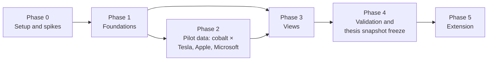

# 03 — Plan

**Document status:** Draft v0.1 (planning stage — no application code yet)
**Last updated:** 2026-11-09
**Related documents:** [Concept](01-concept.md) · [Specification](02-specification.md) · [Backlog](04-backlog.md)

Milestones are relative: dates stay as placeholders (`[YYYY-MM-DD]`) by decision on 2026-11-09 (Q-04 closed). Durations assume one researcher working part-time, about 15 hours per week (A-20).

---

## 1. Phase overview

| Phase | Indicative duration | Milestone |
|---|---|---|
| 0 — Setup and feasibility spikes | 1–2 weeks | **M0** Feasibility confirmed; licence position known — `[YYYY-MM-DD]` |
| 1 — Foundations | 2–3 weeks | **M1** Schema, configuration, taxonomy and library skeleton ready — `[YYYY-MM-DD]` |
| 2 — Pilot data | 3–4 weeks | **M2** Pilot dataset complete (draft) — `[YYYY-MM-DD]` |
| 3 — Views | 3–4 weeks (overlaps Phase 2) | **M3** All views working on pilot data — `[YYYY-MM-DD]` |
| 4 — Validation and freeze | 2 weeks | **M4** Thesis snapshot `v1.0.0-thesis` frozen — `[YYYY-MM-DD]` (must be ≥ 6 weeks before thesis submission, A-21) |
| — | — | **T1** Case-study chapter draft uses snapshot — `[YYYY-MM-DD]` |
| — | — | **T2** Thesis submission — `[YYYY-MM-DD]` |
| 5 — Extension | After M4 (optional before T2) | **M5** v1.1+ releases — `[YYYY-MM-DD]` |

---

## 2. Phase 0 — Setup and feasibility spikes

**Goal:** prove each data source works for this purpose before building, and establish the licence position.

### 2.1 Deliverables
- Repository with publication files (README, LICENSE, DATA_NOTICE, CITATION.cff, CONTRIBUTING, SECURITY, .gitignore, .env.example, data/README) — **done in this session**.
- Four planning documents — **done in this session**.
- Spike log (this section) and decisions.
- Sayari licence position — **done 2026-11-09:** the author confirmed the licence permits publication (recorded in `DATA_NOTICE.md`).
- Explorer prototype spike for front-end decision (Q-17) — *to do*.

### 2.2 Spike results (run 2026-11-09)

Spikes used the Sayari and Tavily MCP tools available in the planning environment, plus an automated HTTP check of seed links. **No raw Sayari output is committed.** The table records only feasibility observations.

| # | Spike | Result | Implication |
|---|---|---|---|
| S1 | **Sayari HS-code lookup** for cobalt codes | Confirmed `2605`/`260500` (ores and concentrates), `2822`/`282200` (oxides and hydroxides), `8105`, `810520`, `810530`, `810590` (cobalt mattes, unwrought, powders, scrap, articles), and `850760` (lithium-ion accumulators). `282739` is "other chlorides", too broad. | Cobalt `minerals` row can be populated. Cobalt sulphate (`2833`) and cathode precursors still to confirm (Q-16). |
| S2 | **Sayari risk-factor definitions** | Catalogue returned 738 factors. About 75 are forced-labour related: UFLPA list and origin (direct/subtier/product-blueprint), WRO, ASPI and Sheffield Hallam report entities, Xinjiang location/registration/operations, ownership links, adverse media, DOL ILAB product–country (child and forced labour), conflict minerals (3TG). Most have a `psa_` variant. | Mapping table drafted in spec §5.4. **Gaps:** no entity-level flags for child labour, private forced labour at mines, or Indigenous/environmental risks. These contexts rely on the library and E2 research (manual). Note: the full catalogue is large (≈ 470 KB); the pipeline should cache it and filter it. |
| S3 | **Sayari entity search** for one large cobalt refiner named in company supplier disclosures | 13 candidate records were returned, including several same-name records in different jurisdictions (some with sparse identifiers) and a separate local-language record. The best candidate had strong identifiers (LEI, national registration code). | Entity resolution is essential (FR-05). Match on identifiers, not names. Expect several records per anchor. |
| S4 | **Sayari upstream supply chain** from that refiner, cobalt HS codes, last 24 months, depth 2 | Returned one upstream tier-2 supplier with shipment countries outside the DRC. No DRC-origin records appeared in this narrow query. | Trade-data coverage for DRC → China cobalt flows may be thin or routed via intermediaries. This is a **key limitation** to test in Phase 2 (wider windows, related HS codes, shipment and supplier search, ownership links to mine operators). It also shows why the anchor method must record "observed-not-found" outcomes. |
| S5 | **Tavily search** — official URLs for UFLPA Entity List, DOL List of Goods, EU Forced Labour Single Portal | All found on official domains. The EU Single Portal is at `single-market-economy.ec.europa.eu` (launched 26 Jun 2026 with guidelines). The UFLPA Entity List page was last updated 28 Oct 2026. The DOL list (as of 5 Sep 2024) includes DRC cobalt ore. | Seed register updated (spec §10). |
| S6 | **Tavily rate limit** | HTTP 429 after about 8 search/extract calls in quick succession. | Throttle (≤ 1 request per 2–3 s), back off, cache all results (NFR-13). Use Tavily only for discovery batches. |
| S7 | **Tavily extract** of SEC documents | Five EDGAR documents confirmed (Apple 2026 DEF 14A, Microsoft 2025 DEF 14A, Nvidia 2026 DEF 14A, Nvidia CY2025 Conflict Minerals Report, Apple 2023 Conflict Minerals Report). Nvidia's report states it surveys **cobalt and mica** via the RMI Extended Minerals Reporting Template (EMRT). | Form SD covers only 3TG. Cobalt disclosure is **voluntary** (EMRT, supplier lists, responsible-sourcing reports). Anchor discovery must use those reports, not only Form SD. |
| S8 | **SEC EDGAR direct access** (automated HTTP) | HTTP 403 without a declared User-Agent. | Pipeline must set `SEC_USER_AGENT` (organisation + contact) per SEC fair-access policy. Re-test in Phase 0 with a proper header. |
| S9 | **Seed link check** (36 URLs) | 23 OK (several redirected to new official URLs, now recorded). 1 not found: Vanguard interpretation guide (404). 1 **redirected to an unrelated third-party domain**: WBA CHRB 2020 ICT methodology asset URL — **must not be used**. 9 blocked by automated checks or timed out (SEC, OECD, DOL, Amnesty, Australian Commissioner, SSGA) — manual check needed. | Spec §10 records status. Find official replacements for the Vanguard guide and CHRB methodology (Q-18). |
| S10 | **N-PX feasibility** | *Not yet run.* | To do: fetch one N-PX filing per manager for one pilot meeting (2024 or later), and check structured XML and fund-level vote fields. |

### 2.3 Remaining Phase 0 tasks
- [ ] S10 N-PX spike (one filing per manager).
- [ ] EDGAR re-test with declared User-Agent; confirm submissions JSON for the 3 pilot CIKs.
- [ ] Explorer prototype spike (Option A, Quarto + OJS): 3-tier flow, keyboard focus, table fallback.
- [x] Sayari licence position (publication permitted — 2026-11-09).
- [ ] Manual check of blocked links; find replacements for the 404 and the hijacked redirect.
- [x] Thesis dates — not needed; milestones stay relative (2026-11-09).
- [x] Board-coding framework and fund-selection rule approved (2026-11-09).

### 2.4 Exit criteria
- All four data channels (Sayari, Tavily, EDGAR, N-PX) return usable data, or a documented workaround exists.
- Sayari licence position recorded in `DATA_NOTICE.md` (summary only).
- Front-end option confirmed (A or C).
- Secrets handled only through environment variables; secret scan passes.

---

## 3. Phase 1 — Foundations

### Deliverables
- **Data model**: schemas for all tables in spec §6.3 (Pydantic/Pandera or JSON Schema) with validation tests.
- **Configuration**: `minerals.yaml` (cobalt complete; graphite and lithium stubs), `companies.yaml` (3 pilot companies + 4 stubs), `risk_contexts.yaml`, `risk_factor_map.csv`, `board_indicators.yaml`, `publish_rules.yaml`, `palette.yaml`.
- **Risk taxonomy**: final palette after CVD simulation; icons; badges; line styles; legend component spec.
- **Risk context library**: five context pages drafted with ≥ 2 post-2020 readings each; XUAR page includes government response; review dates set.
- **Caching layer design** (spec §9.5) implemented in the pipeline skeleton.
- **Wording lint** list (banned phrases) and attribution tests (FR-39–FR-44) defined as automated checks.

### Exit criteria
- Schema validation runs green on sample rows.
- Adding a dummy mineral through config passes the FR-34 test.
- Library pages meet FR-12–FR-15.
- Palette passes CVD simulation, and every colour has icon and text.

---

## 4. Phase 2 — Pilot data (cobalt × Tesla, Apple, Microsoft)

### Work packages
| WP | Task | Output | Notes |
|---|---|---|---|
| 2.1 | **Anchor register** from each company's own disclosures (supplier lists, smelter/refiner lists, EMRT-based cobalt disclosures, responsible-sourcing and impact reports, 2022–2026) | `anchor_suppliers` | Apple and Microsoft may publish cobalt refiner lists; Tesla's impact reports and supplier disclosures to be checked (A-22) |
| 2.2 | **Entity resolution** in Sayari | `entities`, match status | Use identifiers (LEI, national registration codes) |
| 2.3 | **Upstream tracing** (cobalt HS codes, 24-month window, depth 3) + shipment and supplier searches where coverage is thin | `supply_links`, `risk_flags` | Record "no observed link" outcomes |
| 2.4 | **Disclosed vs observed** classification and gap metrics | `supply_links.link_basis` | |
| 2.5 | **Board coding** 2022–2026 (DEF 14A, charters, reports) | `board_coding` | ~3 companies × 5 years × 11 indicators ≈ 165 cells |
| 2.6 | **Company actions** register | `company_actions` | Remedy, recycling, substitution, exit, engagement |
| 2.7 | **Proposals** 2022–2026 including excluded/withdrawn (proxy statements, no-action letters, 8-K Item 5.07) | `proposals` | |
| 2.8 | **Votes** for each Big Three manager via N-PX and manager disclosures, using fund-selection rule | `votes` | |
| 2.9 | **Benchmarks, litigation, regulatory events** | `benchmarks`, `company_actions`/events | KnowTheChain, CHRB, Lead the Charge |
| 2.10 | **Sources** table completed for every record | `sources` | |

### Exit criteria
- All pilot tables populated and schema-valid.
- 100% of rows have a `source_id`; source fields complete (FR-44).
- Every anchor has a match status; PSA dependencies marked.
- Known data gaps listed for the limitations section.

---

## 5. Phase 3 — Views

### Deliverables (in build order)
1. Shared layout: header/footer, version banner, **caveat block**, legend, detail panel, table fallback.
2. **Data download** (early, because it exercises attribution rules on every table).
3. **Supply chain explorer**.
4. **Company view** (then compare mode).
5. **Board oversight grid**.
6. **Proposals and votes timeline**.
7. **Mineral view**.
8. **Risk context library** pages.
9. **Methodology and limitations** page.
10. **Executive summaries** (company and mineral) + print/PDF — last, because they depend on all other data and on researcher-written assessments.

### Exit criteria
- Every view passes the attribution tests (FR-39–FR-44), accessibility checks (NFR-06, NFR-07) and wording lint (NFR-11).
- Executive summaries: 350–450 words, no scroll at 1366×768, one-page print.
- Public build contains no restricted fields (FR-36).

---

## 6. Phase 4 — Validation and thesis snapshot freeze

### Deliverables
- **Second-reviewer coding check**: **deferred** (decision 2026-11-09). The methodology page states single-coder coding as a limitation.
- **Source verification**: every URL re-checked; access dates updated; broken links replaced; *(verify)* markers cleared or explained.
- **Entity-resolution audit**: re-check all "probable" matches; sample of "confirmed".
- **Limitation review** with advisor; wording review of all researcher text.
- **Licence compliance review** of the public build.
- **Thesis snapshot freeze**: `v1.0.0-thesis`, git tag, checksum manifest, archived release (Zenodo or equivalent if approved, Q-02), `version_log` entry, methodology page version locked.

### Exit criteria
- Single-coder limitation stated on the methodology page (second-reviewer check deferred).
- Zero unresolved broken links in the snapshot.
- Advisor sign-off on methodology and limitations.
- Snapshot tag exists and the site shows the snapshot banner.

---

## 7. Phase 5 — Extension

| Step | Scope | Mechanism |
|---|---|---|
| 5.1 | Nvidia, Alphabet, Amazon, Meta (cobalt) | Add `companies` rows + anchor registers |
| 5.2 | Graphite | Add `minerals` row (HS codes via Sayari lookup), readings, mappings |
| 5.3 | Lithium | Same |
| 5.4 | Mica and others | Same |

Each extension is a new MINOR version (`v1.1.0`, `v1.2.0`, …). The thesis snapshot is never changed.

---

## 8. Dependencies

| Dependency | Needed for | Owner | Status |
|---|---|---|---|
| Sayari access and licence position | Phase 2 exposure data; public build design | Researcher | Access works (MCP); publication **permitted** (2026-11-09) |
| Tavily API key and rate limits | Reading discovery | Researcher | Works; rate-limited (S6) |
| SEC EDGAR access with User-Agent | Board, proposals, votes | Researcher | To re-test (S8) |
| N-PX data availability 2022–2026 | Votes | — | To test (S10, Q-20) |
| Approval of coding framework and fund rule | Phase 2.5, 2.8 | Researcher | **Approved** 2026-11-09 |
| Second reviewer | Phase 4 | — | **Deferred** 2026-11-09 |
| Thesis timeline | Milestones | Researcher | Not needed; milestones relative |
| Explorer prototype | Front-end choice | Researcher | To do (Q-17) |

---

## 9. Risk register

Likelihood (L) and impact (I): H / M / L.

| ID | Risk | L | I | Mitigation | Trigger / owner |
|---|---|---|---|---|---|
| R-01 | **Sayari licence limits** publication of entity-level data or IDs | — | — | **Closed 2026-11-09:** the author confirmed publication is permitted. Raw responses are still kept out of git. | — |
| R-02 | **Data gaps** in trade records (artisanal, informal, intermediary-routed DRC flows; S4) | H | H | Use shipment/supplier search, wider windows, ownership links; combine with E2 research and E4 product–country evidence; record "not observed" explicitly; limitations section | Phase 2 coverage review |
| R-03 | **Entity-resolution errors** (same-name records; PSA matches; S3) | H | M | Identifier-based matching; match status; PSA label; audit in Phase 4 | Any anchor with only name match |
| R-04 | **Scope creep** (more companies/minerals before freeze) | M | H | Pilot-first backlog; extension only after M4; MoSCoW enforcement | New request before M4 → backlog "Later" |
| R-05 | **Disclosure bias** (more transparent companies look worse) | H | M | Separate disclosed/observed; explain in summaries; avoid league-table ranking of exposure | Summary writing |
| R-06 | **Unfair or defamatory wording** | L | H | Wording rules and lint; "risk indicator" language; advisor review; corrections process (CONTRIBUTING) | Pre-release review |
| R-07 | **N-PX complexity** (fund-level votes, splits, older unstructured filings) | M | M | Fund-selection rule; manager disclosures as backup; note limitations | S10 result |
| R-08 | **API rate limits / outages** (S6, S8) | M | L | Caching; throttling; offline transforms | Repeated 429/403 |
| R-09 | **Link rot or hijacked URLs** (S9) | M | M | Automated link checker before each release; archive copies (e.g. Wayback) of key public documents; never follow redirects to unrelated domains | Link check failure |
| R-10 | **Accidental commit of secrets or licensed data** | L | H | `.gitignore`, pre-commit secret scan, SECURITY.md process, history rewrite plan | Scan alert |
| R-11 | **Time overrun vs thesis deadline** | M | H | Freeze snapshot ≥ 6 weeks before submission; "Could" items dropped first | Milestone slip > 1 week |
| R-12 | **Board coding subjectivity** (single coder; second review deferred) | M | M | Approved written codebook; evidence locator and short quote for every cell so readers can re-check; limitation stated; second review can be added later | Examiner query on coding |
| R-13 | **Regulatory change during project** (EU FLR guidance, CSDDD Omnibus, UFLPA list updates) | H | L | Library review dates; version log; "as of" dates everywhere | Review date |

---

## Assumptions and open questions — 03-plan.md

**Assumptions**
- **A-20** One researcher, about 15 hours per week, part-time.
- **A-21** The thesis snapshot must be frozen at least 6 weeks before submission, so the chapter can be written against stable data.
- **A-22** Each pilot company publishes enough supplier or refiner information to name at least one cobalt anchor. If not, anchors come from credible third-party reports, labelled as "third-party disclosed".
- **A-23** Spike results from 2026-11-09 are indicative only. Coverage may differ with wider queries.

**Open questions**
- **Q-04** ~~Thesis submission date~~ **Closed 2026-11-09:** not needed.
- **Q-05** ~~Second reviewer~~ **Deferred 2026-11-09.**
- **Q-20** Are N-PX structured data available for all needed years and funds?
- **Q-21** ~~Can raw data be shared with examiners?~~ **Resolved 2026-11-09:** the licence permits publication; the raw cache can be shared on request.
- **Q-22** Should Phase 5 start before thesis submission, or only after?
